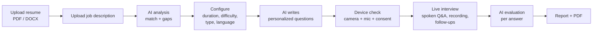

# AI Interview Simulator

Practice realistic AI/ML engineering interviews built from **your resume** and **the job description**.
An AI interviewer asks personalized questions out loud, records your camera and microphone (with consent), lets you
review the transcript of each spoken answer, adapts with follow-up questions, and produces a scored report with
feedback, charts and a downloadable PDF.



## Features

| Area | What it does |
|---|---|
| Documents | Upload a resume and job description as PDF or DOCX (or paste text). Text is extracted on the server, validated (type, size, magic bytes, minimum text), and shown for review. |
| Analysis | Claude extracts skills, projects, experience, internships, education and certifications, then compares them with the job: match score, matching and missing skills, strengths, areas to improve, likely topics. |
| Questions | Personalized questions across Python, SQL, ML, deep learning, generative AI, your projects and HR. The mix depends on interview type, difficulty, duration and the job. Every question is grounded in the documents; the app never claims experience the resume doesn't show. |
| Interview room | Questions are shown and read aloud (text-to-speech), one at a time. You answer verbally; live speech-to-text fills an editable transcript. Pause, resume, skip, repeat and end controls, a progress bar and a timer. Adaptive, non-revealing follow-up questions. |
| Camera and microphone | Both are mandatory. Device check with live preview, microphone level meter, a 5-second playback test, and clear errors for denied, missing or busy devices. Explicit recording consent before starting. |
| Recording | The whole session (video + audio) is recorded with MediaRecorder and uploaded in ordered 5-second chunks while you answer. Each answer's audio is also stored. Everything is private to your account and can be deleted. |
| Evaluation | Each answer gets a 0-10 score plus seven rubric scores, what was right, missing points, mistakes, how to improve, and a stronger example answer. Accent and speaking style are not penalized; nothing is inferred from video. |
| Report | Overall and per-area scores (Python, SQL, ML, DL, GenAI, projects, communication), radar and bar charts, strongest/weakest areas, incorrect answers, topics to revise, next steps and a readiness verdict. Download as PDF. |
| Accounts | Email + password accounts (bcrypt, JWT). Every resume, interview and recording is scoped to its owner. Delete a recording, an interview or the whole account. |
| Languages | English or Telugu interviews (questions in Telugu; feedback in English). |

## Architecture

```
frontend/  React 18 + TypeScript + Vite + Tailwind CSS, Recharts, lucide-react
  ├─ MediaDevices API  -> camera/microphone, level meter, device check
  ├─ MediaRecorder API -> session video (chunked upload) + per-answer audio
  ├─ Web Speech API    -> live speech-to-text (Chrome/Edge)
  └─ speechSynthesis   -> interviewer voice (text-to-speech)
backend/   Python FastAPI REST API
  ├─ SQLAlchemy        -> SQLite (dev) or PostgreSQL
  ├─ pypdf, python-docx-> text extraction
  ├─ Anthropic SDK     -> Claude for analysis, questions, follow-ups, evaluation, report (structured JSON outputs)
  ├─ faster-whisper    -> optional server-side speech-to-text
  ├─ ReportLab         -> PDF reports
  └─ private storage   -> data/storage/user_<id>/interview_<id>/
```

The API key lives only in the backend environment. The browser never sees it.

See [docs/API.md](docs/API.md) for every endpoint and [docs/DATABASE.md](docs/DATABASE.md) for the schema.

## Requirements

- Python 3.11+ and Node.js 20+
- An Anthropic API key ([console.anthropic.com](https://console.anthropic.com/))
- Chrome or Edge for live speech-to-text (other browsers can record and type, or use server-side transcription)
- Camera and microphone access only works on `https://` or `http://localhost`

## Setup

### 1. Backend

```bash
cd backend
python -m venv .venv
source .venv/bin/activate          # Windows: .venv\Scripts\activate
pip install -r requirements-dev.txt
cp .env.example .env               # then set ANTHROPIC_API_KEY and SECRET_KEY
uvicorn app.main:app --reload --port 8000
```

The API docs are then at http://localhost:8000/docs. The database tables are created on first start.

### 2. Frontend (development)

```bash
cd frontend
npm install
npm run dev
```

Open http://localhost:5173. Vite proxies `/api` to the backend on port 8000.

### 3. Try it

1. Create an account.
2. On **New interview**, upload `samples/sample_resume.pdf` (or press **Use sample**), then `samples/sample_job_description.docx`.
3. Review the analysis, configure the interview, pass the device check, accept the consent, and start.

### Single-process production build

```bash
cd frontend && npm run build        # creates frontend/dist
cd ../backend && APP_ENV=production uvicorn app.main:app --host 0.0.0.0 --port 8000
```

FastAPI serves the built app from `frontend/dist`. Put it behind HTTPS (for example Caddy or nginx), since browsers
only allow camera and microphone on secure origins. Use PostgreSQL by setting `DATABASE_URL`, and keep
`STORAGE_DIR` on a private, backed-up volume.

## Configuration

All settings are environment variables; see [`backend/.env.example`](backend/.env.example).

| Variable | Default | Purpose |
|---|---|---|
| `ANTHROPIC_API_KEY` | (required) | Claude API key, server-side only |
| `SECRET_KEY` | (required in production) | Signs login tokens |
| `ANTHROPIC_MODEL` / `ANTHROPIC_EFFORT` | `claude-opus-5-5` / `medium` | Model and reasoning effort |
| `DATABASE_URL` | `sqlite:///./data/app.db` | SQLite or `postgresql+psycopg://…` |
| `STORAGE_DIR` | `./data/storage` | Private recording storage |
| `STT_PROVIDER` | `browser` | `browser` (Web Speech API) or `faster_whisper` (server) |
| `MAX_UPLOAD_MB` / `MAX_RECORDING_MB` | `8` / `500` | Upload limits |

**Server-side transcription (optional):** `pip install -r requirements-stt.txt`, set `STT_PROVIDER=faster_whisper`.
Answer audio is then transcribed on your server when the candidate stops speaking, and audio never leaves your
machine. The first use downloads the Whisper model.

## Tests

```bash
cd backend && pytest                       # 27 API, extraction, security and Claude-client tests
cd frontend && npm test                    # unit tests (Vitest)
cd frontend && npm run build && npm run e2e  # full browser test with fake camera/mic
```

- Backend tests use a test-only fake model (`LLM_PROVIDER=fake`) so they run without network or a key, plus a mocked
  Anthropic HTTP API that checks the exact request the app sends to Claude (model, structured output schema,
  effort, refusal fallback) and the error handling.
- The end-to-end test starts the backend, opens Chromium with fake camera and microphone devices, and runs the whole
  workflow: register, upload PDF/DOCX, analysis, configuration, device check, consent, recorded interview with a
  follow-up, pause/resume, report, PDF download, video playback, recording deletion and phone-width layout.

## Privacy and fairness

- Recording starts only after explicit consent; a REC indicator is always visible.
- Recordings, resumes and reports are visible only to the owning account. Whoever operates the server has
  technical access to its storage, which the consent screen states.
- Only answer transcripts are sent to the AI; video is never analyzed.
- The evaluation prompt forbids penalizing accent, grammar or speaking style, and forbids inferring personality,
  honesty or emotion.
- Candidate documents are passed to the model as delimited data with instructions never to follow text inside them.

## Known limitations

- Live speech-to-text uses the browser's Web Speech API: Chrome and Edge only, and Chrome sends audio to Google's
  speech service. Use `STT_PROVIDER=faster_whisper` to keep audio on your server.
- Telugu speech recognition and a Telugu read-aloud voice depend on the browser and the operating system.
  Feedback is always written in English, and the PDF replaces Telugu script with a note.
- If the page is reloaded mid-interview, recording resumes but appends a second WebM segment to the same file, and
  some players only play the first part.
- The app has no email verification or password reset.

## Project layout

```
backend/app/        FastAPI app: routers/, services/ (engine, prompts, llm, extraction, storage, stt, pdf_report)
backend/tests/      pytest suite
frontend/src/       pages/, components/, hooks/ (media, recording, speech), lib/ (api, auth, types)
frontend/e2e/       Playwright end-to-end test
samples/            fictional sample resume and job description (TXT, PDF, DOCX)
docs/               API.md, DATABASE.md
```
