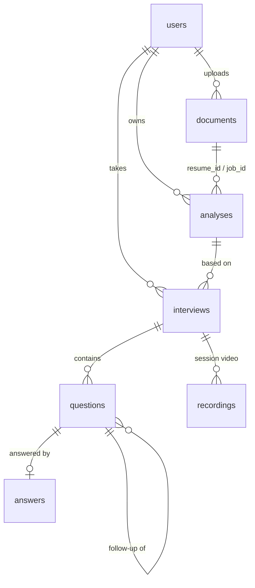

# Database schema

SQLAlchemy models live in `backend/app/models.py`. Tables are created automatically on startup
(`Base.metadata.create_all`). SQLite is the default; set `DATABASE_URL=postgresql+psycopg://…` for PostgreSQL.
Every row hangs off a user, and deleting a user cascades to everything they own (rows and files).



## users
| column | type | notes |
|---|---|---|
| id | integer PK | |
| email | varchar(255), unique | stored lower-case |
| full_name | varchar(120) | |
| password_hash | varchar(255) | bcrypt |
| preferences | JSON | `tts_voice`, `tts_rate`, `auto_speak`, `default_language`, `theme` |
| created_at | timestamptz | |

## documents
| column | type | notes |
|---|---|---|
| id | integer PK | |
| user_id | FK users, cascade | |
| kind | varchar(16) | `resume` or `job` |
| filename | varchar(255) | original name, or "Pasted text" |
| text | text | extracted and cleaned text (the original file is not kept) |
| created_at | timestamptz | |

## analyses
| column | type | notes |
|---|---|---|
| id | integer PK | |
| user_id | FK users, cascade | |
| resume_id, job_id | FK documents, cascade | |
| result | JSON | `{candidate, job, comparison}` as returned by Claude (see `services/schemas_ai.py: AnalysisResult`) |
| created_at | timestamptz | |

## interviews
| column | type | notes |
|---|---|---|
| id | integer PK | |
| user_id | FK users, cascade | |
| analysis_id | FK analyses, cascade | |
| role_title | varchar(255) | "Title at Company" |
| duration_minutes | int | 15, 30, 45, 60 |
| difficulty | varchar(16) | Beginner, Intermediate, Advanced |
| interview_type | varchar(32) | Technical, HR, Project-based, Full interview |
| language | varchar(16) | English, Telugu |
| question_count | int | planned questions (follow-ups are extra) |
| status | varchar(16) | `ready` → `live` ⇄ `paused` → `finished` → `scored` |
| current_index | int | index into the ordered question list |
| followups_asked | int | capped at max(1, question_count / 4) |
| elapsed_seconds | int | reported by the client clock |
| consent_given_at | timestamptz, null | set by `/start`; required before any recording upload |
| started_at, finished_at | timestamptz, null | |
| report | JSON, null | scores, summary and readiness (see API.md) |
| created_at | timestamptz | |

## questions
| column | type | notes |
|---|---|---|
| id | integer PK | |
| interview_id | FK interviews, cascade | |
| position | float | order; follow-ups get the midpoint between two questions |
| category | varchar(16) | python, sql, ml, dl, genai, project, hr |
| topic | varchar(120) | |
| text | text | the question as asked |
| grounding | text | which resume/JD item it comes from |
| followup_of_id | FK questions, null, cascade | set for adaptive follow-ups |

## answers
| column | type | notes |
|---|---|---|
| id | integer PK | |
| question_id | FK questions, unique, cascade | one answer per question |
| transcript | text | final, candidate-reviewed transcript |
| skipped | bool | |
| audio_path | varchar(500), null | relative path in STORAGE_DIR |
| duration_seconds | int | length of the spoken answer |
| score | float, null | 0-10, copied from evaluation |
| evaluation | JSON, null | score, rubric (7 scores), verdict, correct/missing/mistakes, how_to_improve, stronger_answer |
| created_at | timestamptz | |

## recordings
| column | type | notes |
|---|---|---|
| id | integer PK | |
| interview_id | FK interviews, cascade | |
| path | varchar(500) | `user_<id>/interview_<id>/recording.webm` relative to STORAGE_DIR |
| mime_type | varchar(100) | usually `video/webm` |
| size_bytes | int | |
| next_chunk | int | next expected chunk index (uploads are ordered and idempotent) |
| complete | bool | set when the client finishes uploading |
| created_at | timestamptz | |

## Files on disk

```
STORAGE_DIR/
  user_<user_id>/
    interview_<interview_id>/
      recording.webm        # whole session, audio + video
      answer_<question_id>.webm   # each answer's audio
```

Paths are built only from database ids, never from user input, and every read checks the owner first.
Deleting a recording, an interview or an account removes the files too.
